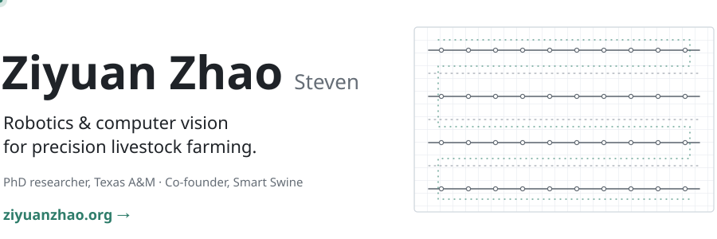

<!-- Profile README. The two SVGs are generated: uv run --with fonttools tools/build.py ; preview: tools/preview.html -->

<a href="https://ziyuanzhao.org"><picture>
  <source media="(prefers-color-scheme: dark)" srcset="assets/hero-dark.svg">
  
</picture></a>

<picture>
  <source media="(prefers-color-scheme: dark)" srcset="assets/now-dark.svg">
  
</picture>

```yaml
perception:  PyTorch · YOLO · OpenCV · RGB-D cameras
robotics:    ROS 2 · PX4 · RTAB-Map · Nav2 · Gazebo
edge:        Raspberry Pi · on-device inference
writing:     LaTeX · draw.io · matplotlib
```

**[ziyuanzhao.org](https://ziyuanzhao.org)** &nbsp;·&nbsp; [Google Scholar](https://scholar.google.com/citations?user=pN4O3wsAAAAJ&hl=en) &nbsp;·&nbsp; [ORCID](https://orcid.org/0009-0003-5750-8921) &nbsp;·&nbsp; [LinkedIn](https://www.linkedin.com/in/steven-zhao-89195326b) &nbsp;·&nbsp; [ziyuanzhao@tamu.edu](mailto:ziyuanzhao@tamu.edu)
