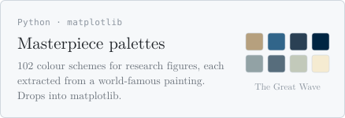
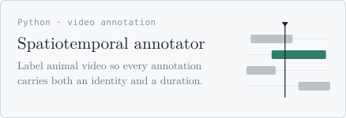
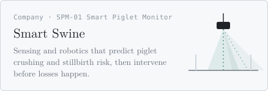
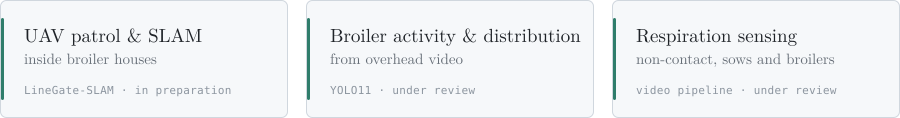

<!-- Profile README. SVGs are generated: uv run --with fonttools --with brotli tools/build.py ; preview: tools/preview.html -->

<picture>
  <source media="(prefers-color-scheme: dark)" srcset="assets/hero-dark.svg">
  
</picture>

<picture>
  <source media="(prefers-color-scheme: dark)" srcset="assets/now-dark.svg">
  
</picture>

### Projects

<p>
<a href="https://github.com/steven068zzy/scientific-figure-color-palettes-from-world-famous-paintings"><picture><source media="(prefers-color-scheme: dark)" srcset="assets/card-palettes-dark.svg"></picture></a>
<a href="https://github.com/steven068zzy/spatiotemporal-annotator"><picture><source media="(prefers-color-scheme: dark)" srcset="assets/card-annotator-dark.svg"></picture></a>
</p>
<p>
<a href="https://steven068zzy.github.io/smartswine/"><picture><source media="(prefers-color-scheme: dark)" srcset="assets/card-smartswine-dark.svg"></picture></a>
<a href="https://github.com/steven068zzy/academic-homepage-template"><picture><source media="(prefers-color-scheme: dark)" srcset="assets/card-homepage-dark.svg"></picture></a>
</p>

<sub>Also here: <a href="https://github.com/steven068zzy/no-yes">no-yes</a>, a Claude Code skill that auto-approves everything &nbsp;·&nbsp; <a href="https://github.com/steven068zzy/stevenZYzhao.github.io">stevenZYzhao.github.io</a>, the source behind ziyuanzhao.org</sub>

### Research

<a href="https://ziyuanzhao.org/#publications"><picture>
  <source media="(prefers-color-scheme: dark)" srcset="assets/research-dark.svg">
  
</picture></a>

<sub>6 journal articles · 2 conference papers · 4 in preparation &nbsp;·&nbsp; <a href="https://scholar.google.com/citations?user=pN4O3wsAAAAJ&hl=en">Google Scholar</a></sub>

### Stack

```yaml
perception:  PyTorch · YOLO · OpenCV · RGB-D cameras
robotics:    ROS 2 · PX4 · RTAB-Map · Nav2 · Gazebo
edge:        Raspberry Pi · on-device inference
writing:     LaTeX · draw.io · matplotlib
```

<sub><a href="https://ziyuanzhao.org">ziyuanzhao.org</a> &nbsp;·&nbsp; <a href="https://scholar.google.com/citations?user=pN4O3wsAAAAJ&hl=en">Google Scholar</a> &nbsp;·&nbsp; <a href="https://orcid.org/0009-0003-5750-8921">ORCID</a> &nbsp;·&nbsp; <a href="https://www.linkedin.com/in/steven-zhao-89195326b">LinkedIn</a> &nbsp;·&nbsp; <a href="mailto:ziyuanzhao@tamu.edu">ziyuanzhao@tamu.edu</a></sub>
